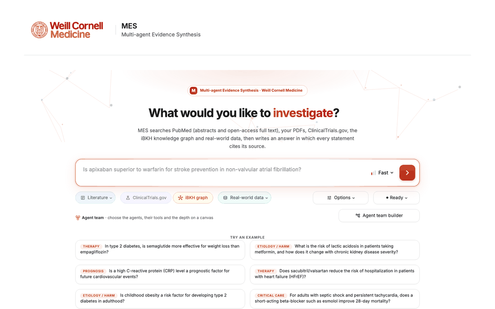
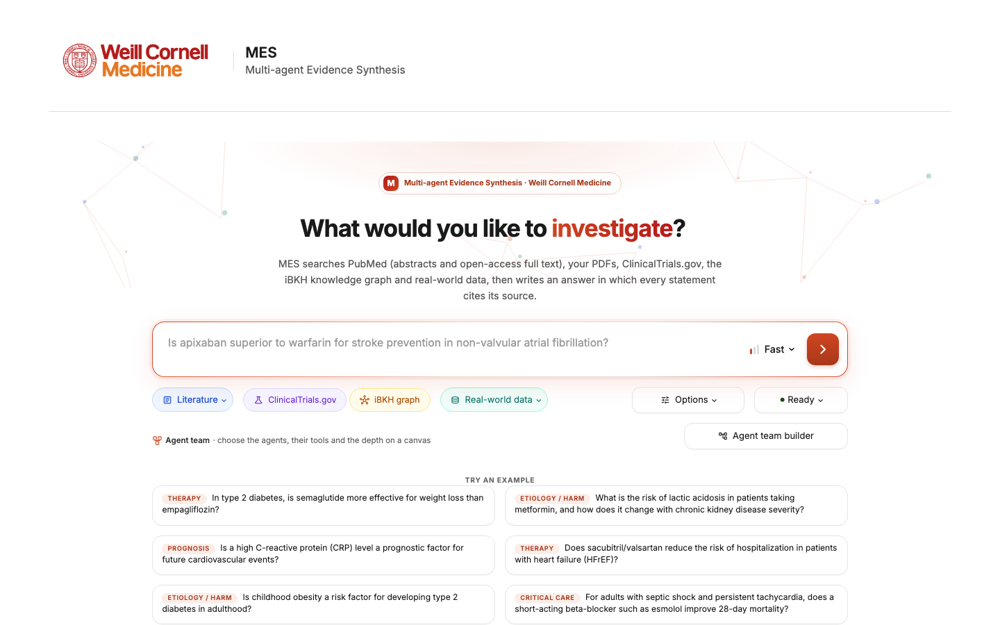
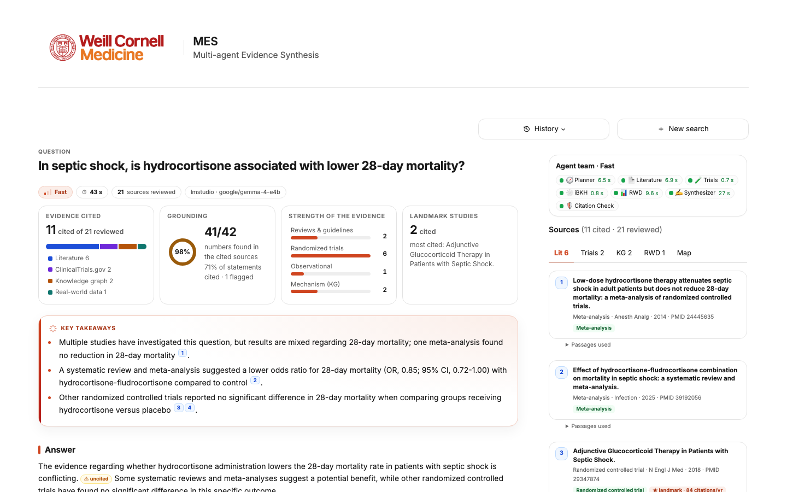
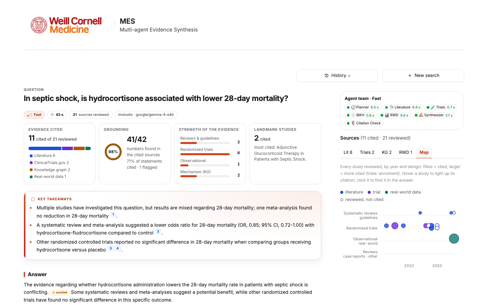
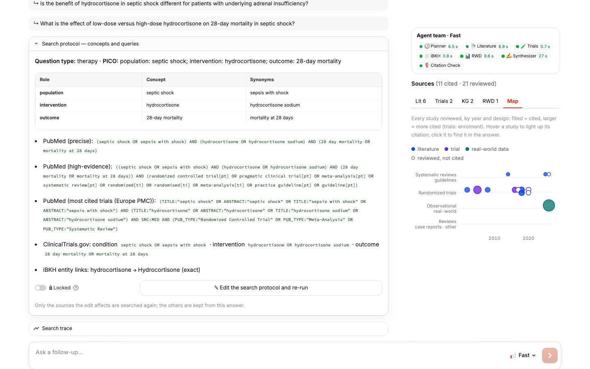
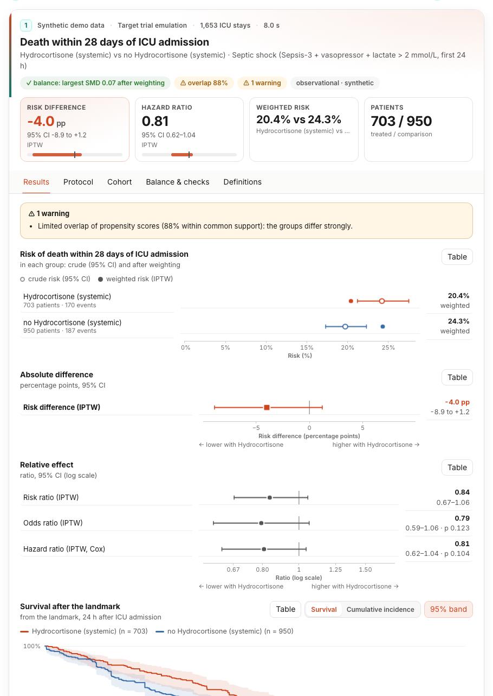
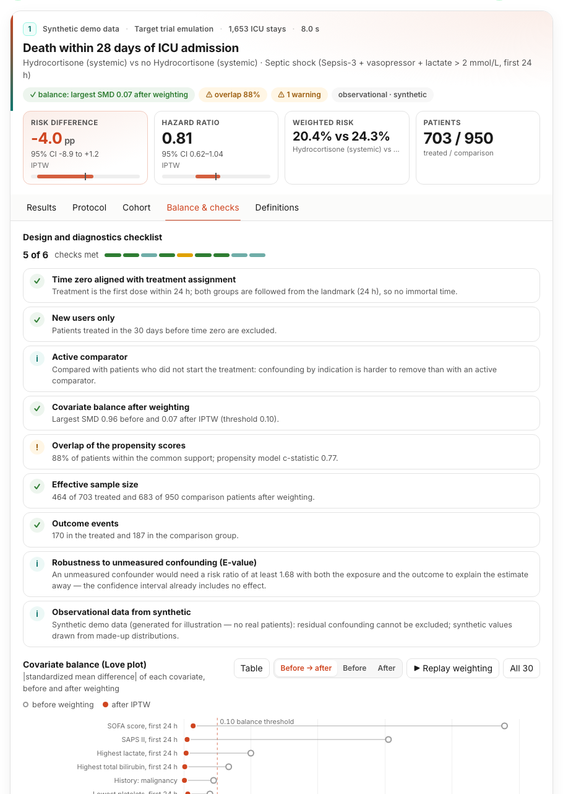

# MES — Multi-Agent Evidence Synthesis

<p align="center">
  
  
  
  
</p>

> **This branch contains MES v2**, the updated system with an enhanced interface and new features. For the
> implementation accompanying the MES manuscript, please see the
> [manuscript version](https://github.com/TrialLab/MES/tree/paper-submission-v1).

**MES** (Multi-Agent Evidence Synthesis) is an agentic system for **medical evidence synthesis**. It turns a
natural-language clinical question into a structured, source-grounded answer that integrates three kinds of evidence:

- **published literature and trial registries**;
- **real-world evidence** generated for the question from electronic health records;
- **biomedical knowledge graphs**.

MES v2 continues the development of MES, introduced in *"MES: A Multi-Agent Evidence Synthesis System for Medical
Decision-Making"* ([medRxiv](https://www.medrxiv.org/content/10.64898/2026.09.15.26362921v1)). MES is under active
development, and new features are added continuously.

<p align="center">
  
</p>

## 🚀 Features

* **🔎 Multi-source evidence.** MES searches several sources in parallel and ranks what it finds by relevance, study
  design, citation impact and recency:
  * PubMed, with open-access full text from Europe PMC and Unpaywall;
  * your own PDF library;
  * ClinicalTrials.gov, with posted results;
  * the iBKH knowledge graph, with structured relations, multi-hop paths and embedding-based entity linking.
* **🏥 Real-world evidence generation.** For each question MES designs and runs a study on MIMIC-IV. Its analyses
  include:
  * target trial emulation with propensity-score weighting and balance diagnostics;
  * survival analysis and prediction;
  * descriptive analyses, trajectories and treatment pathways;
  * retrieval of patients similar to a described one.

  An analyst agent can also write its own analysis code and run it in a sandbox. Its result is reviewed and
  reproduced before use. Patient-level data stay on your computer; the language model sees only the schema, concept
  names and aggregate results.
* **📑 Cited, checked answers.** Every statement cites its evidence, and every number is checked against the source
  it cites. An optional claim-level check screens the cited claims for evidentiary support.
* **⚡ Live and staged answers.** You can watch each agent work while the answer streams in. When the real-world data
  analysis takes longer, a first answer arrives from the other sources and is completed when the analysis ends.
* **🧩 Agent teams and depth.** You choose the agents that answer and their tools. You also choose the depth: Fast,
  Balanced (adds an evidence table and certainty of evidence per outcome) or Deep (searches every facet of the
  question).
* **🔬 Inspect everything.** Each answer shows:
  * the evidence at a glance, a map of the evidence and the knowledge-graph network;
  * the full search protocol;
  * for each real-world data study, an interactive card with results, protocol, cohort, balance and definitions,
    plus a cohort builder, a patient explorer and a trial-vs-cohort comparison.
* **✏️ Edit and re-run.** You can unlock the search protocol, or a study's design, SQL or code, and re-run only what
  the edit changes. Each edit becomes a new version of the answer.
* **💬 Conversations.** Follow-up questions, deeper re-runs, saved history, feedback and exports (HTML report,
  Markdown, JSON).
* **🤖 Hybrid LLM support.** MES runs on cloud OpenAI models with your own API key, or on local models served by
  LM Studio.

## 📸 Screenshots

| Ask | Answer |
|---|---|
|  |  |
| **Sources and the map of the evidence** | **Search protocol, editable behind 🔒** |
|  |  |
| **Real-world data study card** | **Balance and design checks** |
|  |  |

The screenshots and the animation are real runs of the default team with a local model (Gemma 4 E4B in LM Studio).
Their real-world data results come from a **synthetic dataset generated for illustration (no patient data)**, labelled
"Synthetic demo data"; they are not MIMIC-IV results.

## 🛠️ Prerequisites & Installation

### 1. Requirements

* **Python 3.11** (developed and tested on macOS).
* **A language model**, one of:
  * an **OpenAI API key** (default model `gpt-5.4-nano`);
  * **[LM Studio](https://lmstudio.ai)** serving a local model with a 32K context (tested with
    `google/gemma-4-e4b`).
* **Internet access** for PubMed, Europe PMC, Unpaywall and ClinicalTrials.gov, and for downloading the sentence
  encoder from Hugging Face once.
* **Data for two of the sources** ([docs/DATA.md](docs/DATA.md)):
  * the iBKH knowledge-graph store (not included in this repository, see [docs/DATA.md](docs/DATA.md));
  * **MIMIC-IV v2.2**, from your own credentialed PhysioNet access; MES builds its analysis store from it.
  * Until they are in place, those two sources show as unavailable; the literature and ClinicalTrials.gov work
    without them.

### 2. Clone and install

```bash
git clone -b v2 https://github.com/TrialLab/MES.git mes && cd mes
bash mes/scripts/install.sh          # .venv with the tested versions, .env from the template, checks, tests
```

Or by hand: `python3.11 -m venv .venv && .venv/bin/pip install -r requirements-lock.txt`. `environment.yml` creates
a conda environment instead. Behind a TLS-inspecting proxy, add `--use-feature=truststore` to pip.

### 3. Configure your model

Copy `.env.example` to `.env` (git-ignored) and add your key:

```ini
MES_LLM_PROVIDER=openai
OPENAI_API_KEY=your_key_here
MES_OPENAI_MODEL=gpt-5.4-nano
```

For a local model, set `MES_LLM_PROVIDER=lmstudio` instead and start LM Studio:

```bash
lms server start
lms load google/gemma-4-e4b -c 32768 --parallel 4 -y
```

Other settings:

| Variable | Default | |
|---|---|---|
| `OPENAI_ORGANIZATION`, `OPENAI_PROJECT` | empty | optional OpenAI account settings |
| `LMSTUDIO_BASE_URL`, `LMSTUDIO_MODEL` | `http://localhost:1234/v1`, `google/gemma-4-e4b` | the LM Studio server and model |
| `MES_NCBI_API_KEY`, `MES_CONTACT_EMAIL` | empty | faster NCBI access; the e-mail also enables Unpaywall |
| `MES_CONTEXT_BUDGET` | `24000` | characters of evidence per answer (scaled by depth) |
| `MES_IBKH_DIR`, `MES_MIMIC_DIR`, `MES_PDF_DIR` | `data/ibkh`, `data/mimic`, `data/pdfs` | local stores |
| `MES_RWD_ANALYST` | `auto` | the code-writing RWD analyst agent; `on` runs it with your model |
| `MES_PROTOCOL_EDIT` | `on` | protocol editors: `on`, `no_code`, `off` |

The full list is in [.env.example](.env.example).

## 🏃 Usage

```bash
./run.sh --open                      # MES at http://localhost:8501 (macOS: or double-click MES.command)
```

**A first question:**

1. Type *"Does sacubitril/valsartan reduce the risk of hospitalization in patients with heart failure (HFrEF)?"*.
2. Keep the default team (literature, ClinicalTrials.gov, the knowledge graph and real-world data) and choose
   **Fast**.
3. Watch the agents work and the answer stream in. You then get:
   * key takeaways and the answer, with numbered citations (hover a citation to see its passage);
   * the grounding of every number;
   * the sources and the search protocol;
   * **Export** for HTML, Markdown or JSON.
4. Ask a follow-up in the box under the answer, or **Go deeper** for a Balanced or Deep answer.

**From the command line:**

```bash
python -m mes.workflow "Is apixaban superior to warfarin for stroke prevention in atrial fibrillation?" --mode fast
python -m mes.workflow "..." --agents            # run the question through the agent orchestrator
```

## 🔌 External Services & Data

| Resource | Used for |
|---|---|
| NCBI E-utilities (PubMed) | literature search and records (≤ 3 requests/s without an API key) |
| Europe PMC, Unpaywall | citation counts and open-access full text (Unpaywall needs `MES_CONTACT_EMAIL`) |
| ClinicalTrials.gov API | trial registrations and posted results |
| Hugging Face | the sentence encoder `sentence-transformers/all-MiniLM-L6-v2` (downloaded once) |
| OpenAI API or LM Studio | the language model |
| [iBKH](https://github.com/wcm-wanglab/iBKH) | the biomedical knowledge graph ([docs/DATA.md](docs/DATA.md)) |
| [MIMIC-IV](https://physionet.org/) | real-world data; credentialed access, never redistributed ([docs/DATA.md](docs/DATA.md)) |

## 📂 Repository Structure

* `mes/app.py`: the web app (Streamlit); `run.sh` starts it.
* `mes/ui/`: the page, the interactive charts (`ui/web/`) and the agent team builder.
* `mes/tools/`: query planning, the evidence sources, synthesis and checks, protocol editing; `tools/rwd/` holds the
  real-world data analysis.
* `mes/mes_agents.py`, `mes/workflow.py`: the agents, the orchestrator and the command line.
* `mes/scripts/`: the installer, the store builders (`build_ibkh_kg.py`, `build_mimic_db.py`) and UI checks.
* `mes/tests/`: offline tests (`python -m pytest mes/tests -q`).
* `docs/`: data instructions and screenshots.

## 📝 Citation

If you use MES, please cite:

```bibtex
@article{li2026mes,
  title   = {MES: A Multi-Agent Evidence Synthesis System for Medical Decision-Making},
  author  = {Li, Haoyang and Pan, Weishen and Rajendran, Suraj and Zang, Chengxi and Gabeskiria, Judy and
             Liu, Valencia and Feng, Vivian and Penmetsa, Mahitha and Lin, Lydia and Jayakar, Atindra Bhalchandra and
             Boucher, Ayham and Schenck, Edward J. and Yang, He S. and Wang, Fei},
  journal = {medRxiv},
  year    = {2026},
  doi     = {10.64898/2026.09.15.26362921},
  url     = {https://www.medrxiv.org/content/10.64898/2026.09.15.26362921v1}
}
```

## ⚠️ Disclaimer

MES is a research tool, not a medical device, and its answers are not medical advice. Its real-world evidence is
observational and comes from the databases you connect.

## 📜 License

MIT, see [LICENSE](LICENSE). Third-party components, data and services are listed in
[THIRD_PARTY_NOTICES.md](THIRD_PARTY_NOTICES.md).
